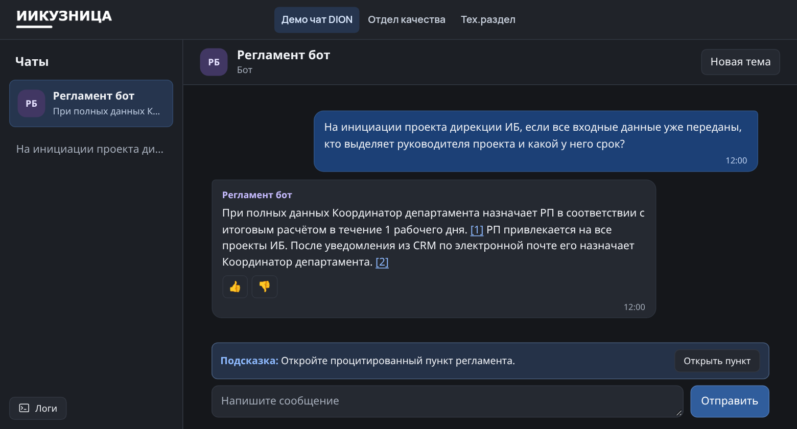

# ИИкузница

ИИкузница помогает сотрудникам найти ответ в регламентах Softline и проверить его по первоисточнику. В демочате DION каждая нормативная ссылка открывает пункт конкретной редакции. Если для ответа не хватает условий, бот уточняет вопрос. Если в регламентах есть пробел, сотрудник может передать его в Отдел качества и получить ответ в том же чате.

**[Открыть демостенд](https://corpdoc.single-tech.ru/)** · [Сценарии для организатора](docs/architecture/product-release.md) · [План пилота](docs/pilot-softline.md)

[](https://github.com/gureev1988-ops/iikuznica/actions/workflows/core-checks.yml) [](https://github.com/gureev1988-ops/iikuznica/actions/workflows/release-smoke.yml)



*Пример диалога из приёмочной проверки, воспроизведённый в интерфейсе стенда.*

## Что посмотреть на стенде

1. Откройте «Демо чат DION» как гость. Задайте вопрос «На инициации проекта дирекции ИБ, если все входные данные уже переданы, кто выделяет руководителя проекта и какой у него срок?»
2. Откройте ссылку у ответа. В п. 2.7 регламента «Проектная деятельность Дирекции ИБ» указан координатор департамента и срок в один рабочий день. Из цитаты можно перейти к полной редакции и скачать оригинал.
3. В «Отделе качества» откройте карточку ОК1. Сравните срок в учебном письме (6 рабочих дней) с действующим п. 1.6 регламента ДБРЦТ (7 рабочих дней). В карточке доступны и переписка, и нормативное основание.
4. Откройте «Тех.раздел», чтобы увидеть план пилота, схему обработки вопросов и роль моделей. Демо работает на четырёх учебных регламентах. Расширение на 100+ регламентов описано в плане пилота.

## Локальный запуск

Понадобятся Git, Docker с Compose v2 и OpenSSL. Для ответов моделей задайте в окружении `OPENROUTER_API_KEY` с доступом к Gemma, Qwen и OpenRouter Decisions. При первом запуске сборка скачает веса MiniLM и импортирует документы.

```sh
git clone https://github.com/gureev1988-ops/iikuznica.git
cd iikuznica
./deploy/init-env.sh
docker compose up -d --build --wait
```

Откройте [локальный стенд](https://localhost:4443). Caddy использует локальный центр сертификации. Его сертификат можно получить из контейнера и проверить готовность API по HTTPS.

```sh
docker compose exec -T https cat /data/caddy/pki/authorities/local/root.crt > local-ca.pem
curl --cacert local-ca.pem https://localhost:4443/healthz
```

## Доступ к демостенду и смена пароля

Для чата и просмотра учебных материалов достаточно гостевой сессии. Чтобы ответить на письмо или отредактировать разъяснение, нажмите «Войти» в «Отделе качества». В стандартной учебной конфигурации логин и пароль — `admin`. Участники стенда видят общие учебные письма и карточки, а история чата у каждого браузерного профиля своя.

При самостоятельном запуске задайте в `.env` значения `II_DEMO_EXPERT_LOGIN` и `II_DEMO_EXPERT_PASSWORD`. Если задать обеим переменным пустые значения, демовход отключится. Для служебного входа скрипт инициализации создаёт `II_JUDGE_LOGIN` и `II_JUDGE_PASSWORD`. При замене служебного пароля используйте не менее 16 символов. Чтобы применить настройки локально, пересоздайте сервисы приложения.

```sh
docker compose up -d --no-deps --force-recreate api interactive background
```

На VPS эти параметры хранятся в `shared/production.env`. [Настройка и применение выпуска](docs/backend/vps-deploy.md#первичная-настройка)

## Документация

| Задача | Материалы |
| --- | --- |
| Проверить демонстрацию | [Сценарии, устройство стенда и результаты измерений](docs/architecture/product-release.md) · [Четыре исходных регламента и глоссарий](corpus/) |
| Подготовить пилот | [Этапы и критерии пилота в Softline](docs/pilot-softline.md) · [Запуск и переключение на локальные модели](docs/backend/local-models.md) · [Как подключить ещё один источник](docs/backend/run.md#как-подключить-ещё-один-источник) |
| Изменить интерфейс или API | [Макет и дизайн-система](docs/design/README.md) · [Контракты OpenAPI и типы TypeScript](contracts/README.md) |
| Запустить проверки или развернуть стенд | [Руководство для участников](CONTRIBUTING.md) · [Приёмка сборки](docs/backend/assembly-run.md) · [Развёртывание на VPS](docs/backend/vps-deploy.md) |

Об ошибке в работе стенда или неточной ссылке на регламент можно сообщить в [GitHub Issues](https://github.com/gureev1988-ops/iikuznica/issues).
