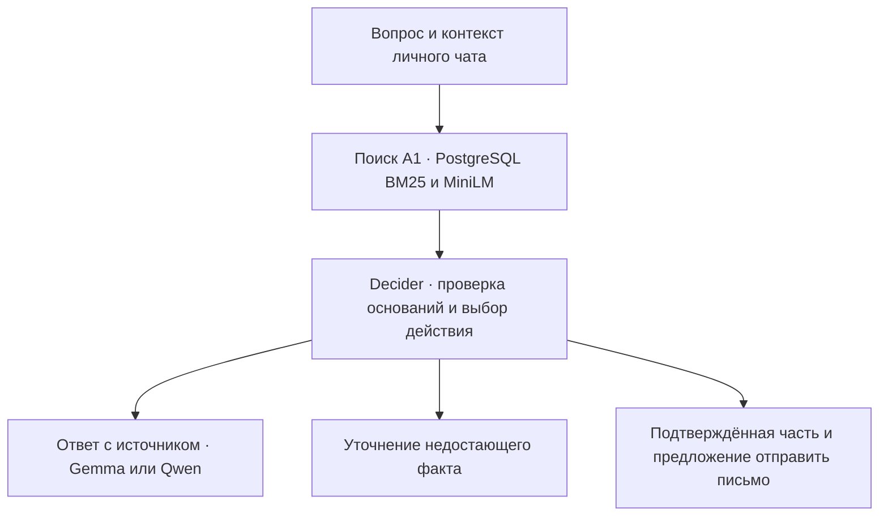
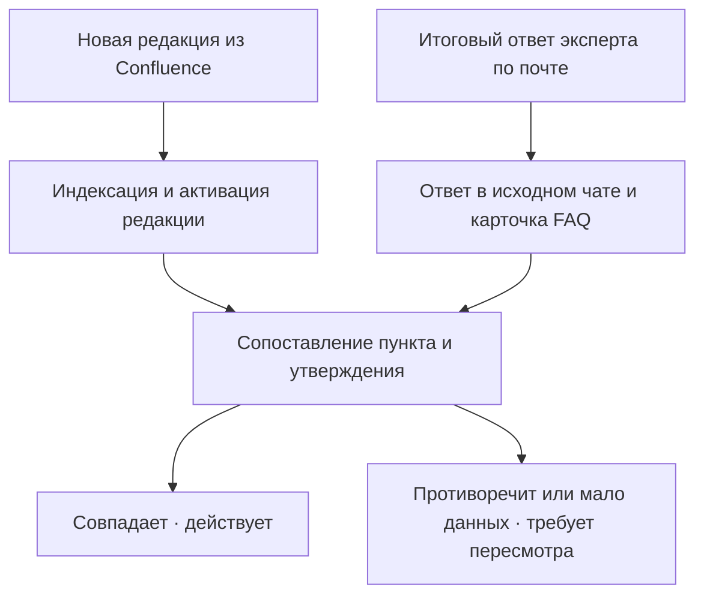
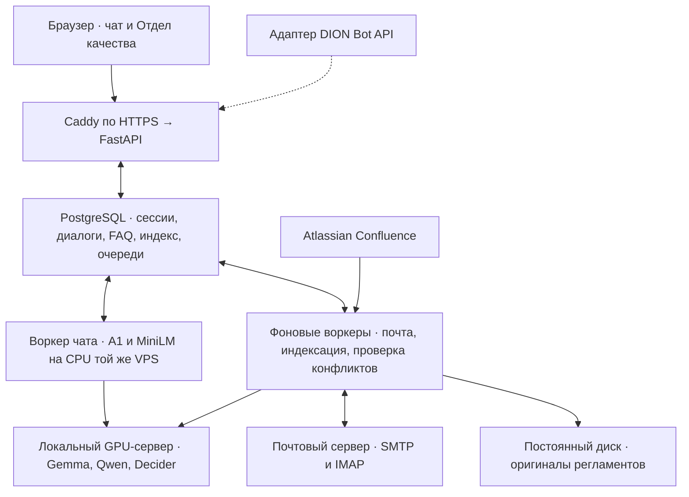

# Тех.раздел ИИкузницы

27 ноября 2026. Материал для показа и реализации. [Интерактивный макет](https://chatgpt.com/library?file_id=libfile_77f91857fd488191b8f059b71557c477&no_universal_links=1).

## Как работает чат

Gemma отвечает на обычные вопросы и участвует в проверке допустимости действия. Qwen обрабатывает полные процедуры и восстанавливает тему сложных продолжений. Для проверенного маршрута полных процедур reasoning выключен. Если нужен внешний ответ, бот отправляет письмо после согласия пользователя. Схема укрупняет ветвления и повторный поиск. [Контракт сборки и модели](https://github.com/gureev1988-ops/iikuznica/blob/595eadf5108ad3de12b0ee4fe617b723e0090244/docs/architecture/assembly-v1.md).

## Как работают разъяснения

Поиск подбирает норму для той же дирекции, этапа и условий. В локальном варианте Perplexity Decider Flash v1.3 получает утверждение и применимый пункт, возвращает один из трёх вердиктов и указывает основания. Интерфейс показывает спорную фразу и пункт. Расхождение и нехватку данных различаем в объяснении. При расхождении в ответах бот опирается на действующий регламент. Стартовый пример — 6 рабочих дней в письме против 7 рабочих дней в п. 1.6 ДБРЦТ. [Права и начальные данные](https://github.com/gureev1988-ops/iikuznica/blob/f282cbe43359e0a18c6420507913f295e358ac87/docs/architecture/dion-demo-ui.md#права-и-начальные-данные).

## Интеграции

| Интеграция | Что есть в коде и используется в показе |
| --- | --- |
| DION Bot API | Сетевой адаптер находится в репозитории. Вход в демо идёт через браузерный чат. |
| Почта | Веб-клиент и тестовый SMTP/IMAP. Ответ эксперта возвращается в нужный чат и создаёт разъяснение. |
| Atlassian Confluence | Коннектор получает страницы и редакции. На демо используется подготовленный снимок регламентов. |

[Документация стенда](https://github.com/gureev1988-ops/iikuznica/blob/595eadf5108ad3de12b0ee4fe617b723e0090244/docs/backend/assembly-run.md).

## Модели, нагрузка и ресурсы

- **Приложение.** 4 vCPU, 8 ГБ RAM и 80 ГБ SSD — рекомендуемый размер VPS. MiniLM ранжирует результаты на CPU этой же VPS. Демостенд обращается к моделям через OpenRouter. [Требования к VPS](https://github.com/gureev1988-ops/iikuznica/blob/595eadf5108ad3de12b0ee4fe617b723e0090244/docs/backend/vps-deploy.md).
- **Локально с Qwen.** Ориентир — около 144 ГБ VRAM для одновременной работы Gemma 4 26B A4B и Qwen3.5 122B A10B в Q4 и Decider Flash v1.3 в BF16. Пример распределения — две карты по 48 ГБ под Qwen и одна 48 ГБ под Gemma и Decider. Примерные размеры файлов весов — 16,8 ГБ Gemma, 74,2 ГБ Qwen и около 9 ГБ Decider, суммарно около 100 ГБ. Ориентир заказчика 128 ГБ относится к весам при Q4 или выше. Для полного запуска на GPU с ограничением 128 ГБ требуется измерить пики с контекстом и параллельными запросами. 144 ГБ — вариант с запасом для полного контура. [Требование заказчика](https://chatgpt.com/library?file_id=libfile_ecd567526d20819189c57d21d22431ab&account_id=personal) · [Gemma Q4](https://huggingface.co/tpnlabs/gemma-4-26B-A4B-it-TPN-GGUF) · [Qwen Q4](https://huggingface.co/mradermacher/Qwen3.5-122B-A10B-GGUF/tree/main) · [Decider BF16](https://huggingface.co/perplexity-ai/pplx-decider-flash-v1.3).
- **Локально с Gemma и Decider.** Ориентир — 48 ГБ VRAM. При отключении Qwen Gemma берёт полные процедуры. Сложное продолжение можно обработать облегчённым маршрутом или запросить недостающий факт. Обычный уточняющий диалог сохраняется. Память, качество и задержки проверяются на том же корпусе и целевой параллельности.

### Что дали Qwen и reasoning

| Тест | Результат |
| --- | --- |
| Слепое сравнение на 50 обычных вопросах | 49/50 пригодных ответов у Qwen и 48/50 у Gemma. Верное действие — 49/50 у обеих. Медиана задержки API — 3,90 с у Qwen и 0,70 с у Gemma. |
| 10 первых полных процедур, одинаковый расширенный поиск, reasoning выключен | Qwen 8/10, Gemma 7/10. Разница — один зачёт. Само расширение поиска при той же Gemma улучшило результат с 5/10 до 7/10. |
| На тех же 10 процедурах с reasoning | Gemma осталась на 7/10. Qwen снизилась с 8/10 до 6/10. Задержка выросла у обеих моделей. |
| Сквозное сравнение маршрутов на 92 ходах | Обычные вопросы — 50/50 в обоих вариантах. Сложные ходы — 35/42 у кандидата и 34/42 у базы. Целые многоходовые диалоги — 3/5 у обоих. Qwen восстанавливала тему в обоих вариантах. Для оценки полного отключения нужен отдельный парный прогон. |

На этих панелях более крупная модель дала точечный выигрыш. Включение reasoning пользы по зачётам не принесло. [Слепое сравнение моделей](https://github.com/gureev1988-ops/iikuznica/blob/6193afae96d36989f8720fa0f773e6607a015bd2/eval/scope/model-comparison-summary.md) · [Протокол процедур и сквозных прогонов](https://github.com/gureev1988-ops/iikuznica/blob/6193afae96d36989f8720fa0f773e6607a015bd2/eval/conversations/reasoning-results.md).

**Оценка для рабочего потока.** В контрольной смеси 50 обычных и 42 сложных ходов было 10 первых полных процедур, около 11%. Это состав тестового набора. Фактическая частота вызовов Qwen также зависит от продолжений. Для приближённого расчёта берём разницу в 10 п.п. незачётов на полных процедурах и умножаем её на предполагаемую долю таких вопросов:

| Допущение о доле полных процедур | Прибавка незачётов без Qwen |
| --- | --- |
| 5–7% | +0,5–0,7 п.п., примерно 1–1,4 на 200 вопросов |
| 10% | +1 п.п., примерно 2 на 200 вопросов |
| Около 11%, как в контрольной смеси | +1,1 п.п., примерно 2,2 на 200 вопросов |

Это сценарная оценка для первых полных процедур. Для выбора профиля с 48 ГБ VRAM на пилоте считаем долю ходов с Qwen отдельно для генерации и восстановления темы. Влияние на продолжения проверяем парным прогоном. Локальный Decider требует доступ к весам и проверку паритета с ответами API.

### Масштабирование

1. Автотест очереди PostgreSQL с имитатором модели отправляет всплески 10, 20 и 200 запросов. Проверяет приём, завершение принятых запросов и управляемый отказ при переполнении.
2. Условный рабочий профиль — около 640 вопросов за 8 часов при всплеске 20 вопросов каждые 15 минут. Пропускную способность и p95 на реальных моделях измеряем отдельно.
3. Добавляем интерактивные воркеры независимо от почты и индексации. Модельные мощности масштабируем по задержке очереди и загрузке GPU.

[Нагрузочный тест](https://github.com/gureev1988-ops/iikuznica/blob/595eadf5108ad3de12b0ee4fe617b723e0090244/tests/acceptance/test_burst.py).

## Архитектура приложения

Схема показывает локальный профиль. На демостенде модельные вызовы идут через OpenRouter. Пунктиром обозначен адаптер корпоративного DION.
