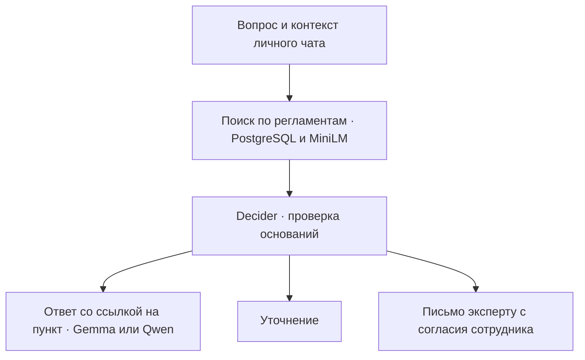
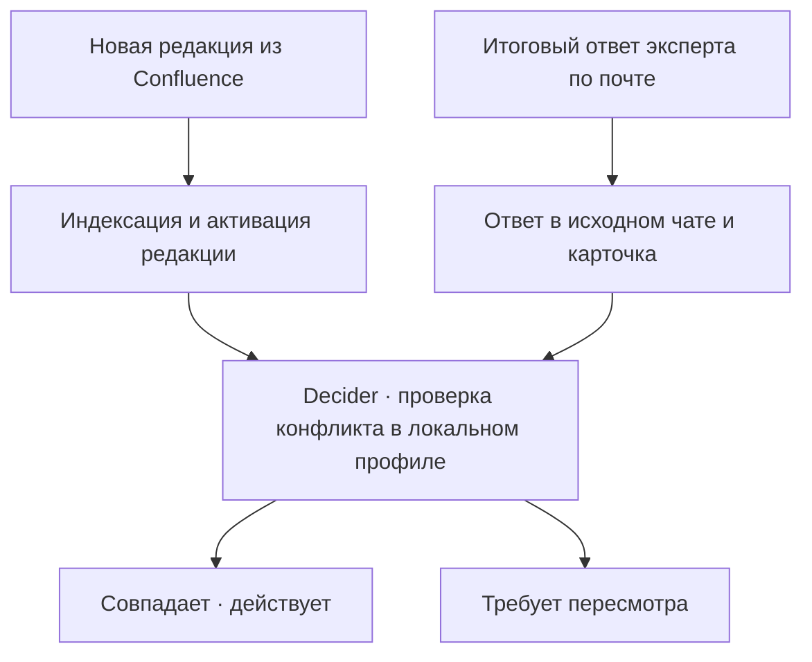
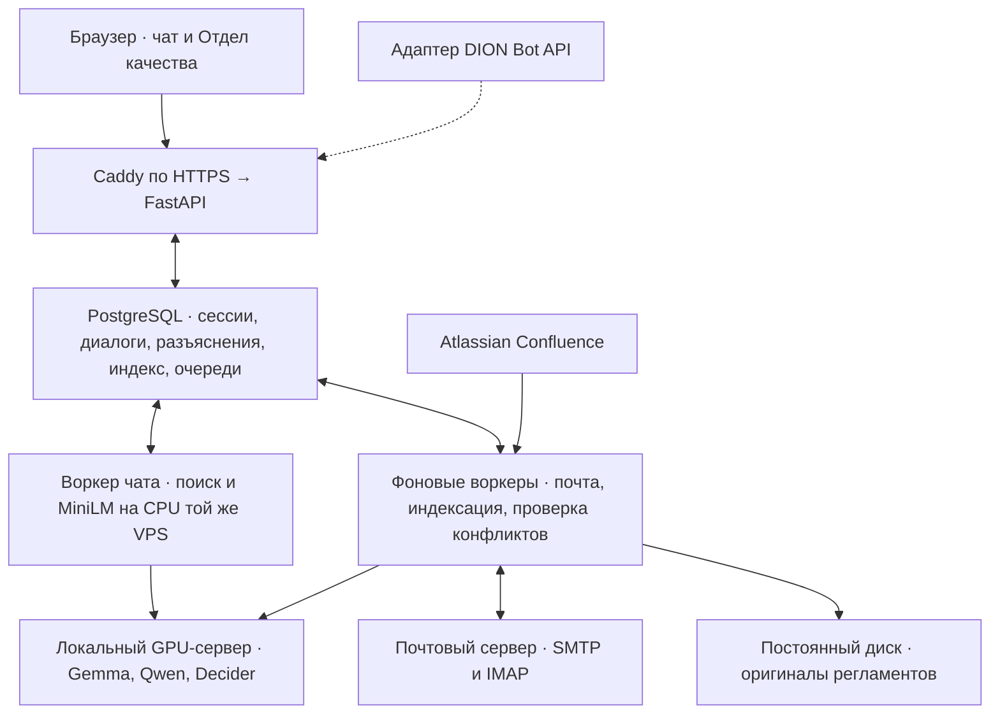

# Тех.раздел ИИкузницы

27 ноября 2026. Материал для показа и реализации. [Интерактивный макет](https://chatgpt.com/library?file_id=libfile_77f91857fd488191b8f059b71557c477&no_universal_links=1).

## Как работает чат

Gemma отвечает на обычные вопросы. Qwen обрабатывает сложные вопросы и продолжения.

## Как работают разъяснения

При расхождении карточка требует пересмотра, а бот опирается на действующий регламент.

## Интеграции

| Интеграция | Назначение |
| --- | --- |
| DION Bot API | Адаптер корпоративного чата. На демостенде чат открывается в браузере. |
| Почта | Веб-клиент и тестовый SMTP/IMAP. Ответ эксперта возвращается в чат и создаёт разъяснение. |
| Atlassian Confluence | Коннектор получает страницы и редакции. На демо используется подготовленный снимок регламентов. |

## Модели и ресурсы

| Профиль | Ресурсы |
| --- | --- |
| Приложение | 4 vCPU, 8 ГБ RAM, 80 ГБ SSD. MiniLM работает на CPU той же VPS. |
| Полный локальный профиль | **128 ГБ VRAM** — расчётная конфигурация на **200 запросов в день**. Gemma, Qwen и Decider. |
| Лёгкий локальный профиль | Около **48 ГБ VRAM**. Gemma и Decider. |

На демостенде модели работают через OpenRouter. В тестах Qwen дала точечный выигрыш. Режим reasoning увеличил задержку без роста качества.

При доле сложных вопросов **11%** расчёт для профиля без Qwen — **+1,1 п.п. незачётов**, примерно **2 ответа на 200 запросов**.

## Масштабирование

Очередь проверена на всплесках до 200 тестовых запросов. Воркеры и модельный сервер масштабируются независимо.

## Архитектура приложения

Схема показывает локальный профиль. На демостенде модельные вызовы идут через OpenRouter. Пунктиром обозначен адаптер корпоративного DION.

## Основания расчёта

- Полный локальный профиль предполагает Gemma и Qwen в Q4 и Decider Flash v1.3 в BF16. Веса занимают суммарно около 100 ГБ. Для 200 запросов в день ожидаем достаточность 128 ГБ при ограниченной параллельности. Пиковую память оборудования и задержки подтверждаем нагрузочным прогоном. Лёгкий профиль на 48 ГБ использует Gemma и Decider. [Параметры VPS](https://github.com/gureev1988-ops/iikuznica/blob/595eadf5108ad3de12b0ee4fe617b723e0090244/docs/backend/vps-deploy.md) · [Требования заказчика](https://chatgpt.com/library?file_id=libfile_ecd567526d20819189c57d21d22431ab&account_id=personal).
- На полных процедурах с одинаковым поиском и выключенным reasoning Qwen получила 8/10, Gemma — 7/10. На обычных вопросах было 49/50 против 48/50. С reasoning Gemma сохранила 7/10, Qwen снизилась до 6/10. [Сравнение моделей](https://github.com/gureev1988-ops/iikuznica/blob/6193afae96d36989f8720fa0f773e6607a015bd2/eval/scope/model-comparison-summary.md) · [Протокол процедур](https://github.com/gureev1988-ops/iikuznica/blob/6193afae96d36989f8720fa0f773e6607a015bd2/eval/conversations/reasoning-results.md).
- Доля 11% взята из контрольной смеси, где 10 первых полных процедур на 92 хода. При сохранении разницы в 10 п.п. на этих вопросах получаем 11% × 10 п.п. = 1,1 п.п., или 2,2 дополнительных незачёта на 200 запросов. Влияние на сложные продолжения требует отдельного парного прогона.
- Всплеск до 200 относится к тесту очереди с имитатором модели. [Проверка очереди](https://github.com/gureev1988-ops/iikuznica/blob/595eadf5108ad3de12b0ee4fe617b723e0090244/tests/acceptance/test_burst.py).
